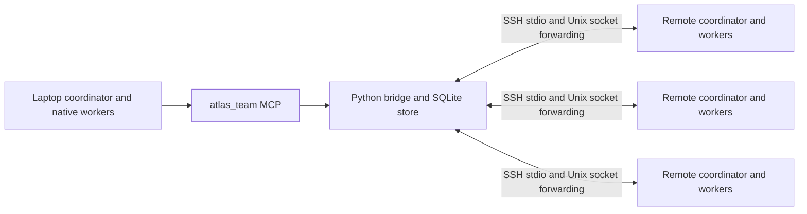

# Architecture and trust boundaries

## Processes

1. The laptop Codex client launches `teamctl.py mcp` as an adapter forwarding tool requests to a private local Unix socket.
2. `teamctl.py serve` is the manually started laptop bridge. It owns SQLite coordination state and one SSH connection per configured host.
3. SSH invokes `remote_launch.py`. The bridge sends a one-line credential envelope through encrypted stdin; the launcher sets `AMSC_TOKEN` and replaces itself with `~/.local/bin/codex app-server --stdio`.
4. Remote coordinators create native subagents. Their MCP adapter reaches the laptop store through a reverse-forwarded private Unix socket.

No TCP listener is opened by the bridge. Connecting starts no model work. The bridge is independent of the desktop app's managed app-server daemon and is not a login service.

## Coordination

Execution state is keyed by `(run_id, host)`; messages, tasks and artifact revisions are shared by `run_id`. There is one active coordinator per remote host and at most 16 native workers per coordinator. The laptop limit is configured separately. Active-thread inventory reads loaded sessions, including attached native children.

The default host uses mailbox `remote-coordinator`; others use `remote-coordinator:HOST`. Worker names must be unique across the run, preferably `HOST:ROLE-NUMBER`. Host-specific task and artifact names should also have prefixes. Intentionally shared work uses common task or artifact IDs.

Within a host, agents use native collaboration. Across hosts, use durable inboxes with explicit acknowledgement. Poll at checkpoints and between substantial steps, with at most a 30-second wait. Long work can delay message processing. Only active remote coordinator mailboxes support push through `turn/steer`; workers and laptop chats must poll. This coordinates separate native sessions.

Claims are atomic, exclusive and bounded to 1800 seconds. Completion requires the matching owner and token before expiration. Deadlines do not kill processes; the coordinator enforces them. Artifacts use immutable text revisions, author, SHA-256 and optimistic `expected_revision` checks. Text is limited to 512 KiB; larger files should be staged and hash-verified before canonical import.

Disconnection marks affected active runs uncertain and never automatically repeats model work. Reconcile saved state/events before continuing. Laptop project files are canonical; remote snapshots can diverge and are not automatically synchronized.

## Credentials and sandboxing

This distribution supports trusted users and machines under one operator. It does not authenticate mutually untrusted tenants or enforce per-agent identity isolation.

The provider token travels through SSH stdin into the remote app-server environment. The bridge does not write it into a file or arguments. Remote shell snapshots and login shells are disabled; native shell commands inherit core variables and explicitly exclude `AMSC_TOKEN`. Sufficiently privileged remote processes can still access the token. Keep runtime records and credentials private.

Native execution uses `workspace-write`; network access is enabled for authorized work. Internal MCP tools are preapproved for coordination. Unsupported interactive command/file approval and user-input prompts are declined and recorded; agents must report blocks.

Ubuntu namespace restrictions remain enabled. The optional administrator script installs only the reviewed bubblewrap AppArmor profile and retains an undo marker. See [Deployment](deployment.md).

## Compatibility

The implementation is pinned to Codex 0.166.0-alpha.6 and MAG. Direct SSH is implemented; PBS/Slurm allocation is not. Extra hosts do not expand provider quotas or run the language model locally. Protocol/provider upgrades require review and bounded compatibility tests.
